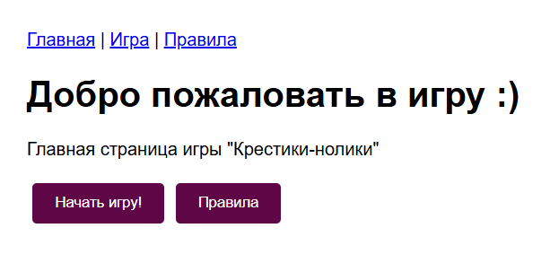
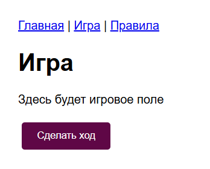
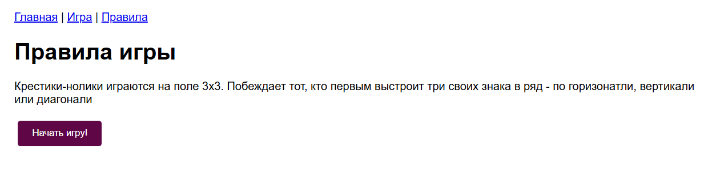

# Разработка игры «Крестики-нолики» с ИИ-соперником и выбором сложности на языке JavaScript

Курсовая работа.

## Описание проекта
Веб-приложение для игры в «Крестики-нолики» против компьютера с выбором уровня сложности. 
Проект разделен на библиотеку компонентов (`ui-library`) и основное приложение (`frontend`).

## Инструкция по запуску

### 1. Запуск библиотеки компонентов
```bash
cd ui-library
npm install
npm run build
```
### 2. Запуск основного приложения
```bash
cd frontend
npm install
npm run dev
```
## Скриншоты работы приложения



